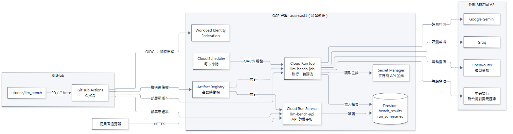
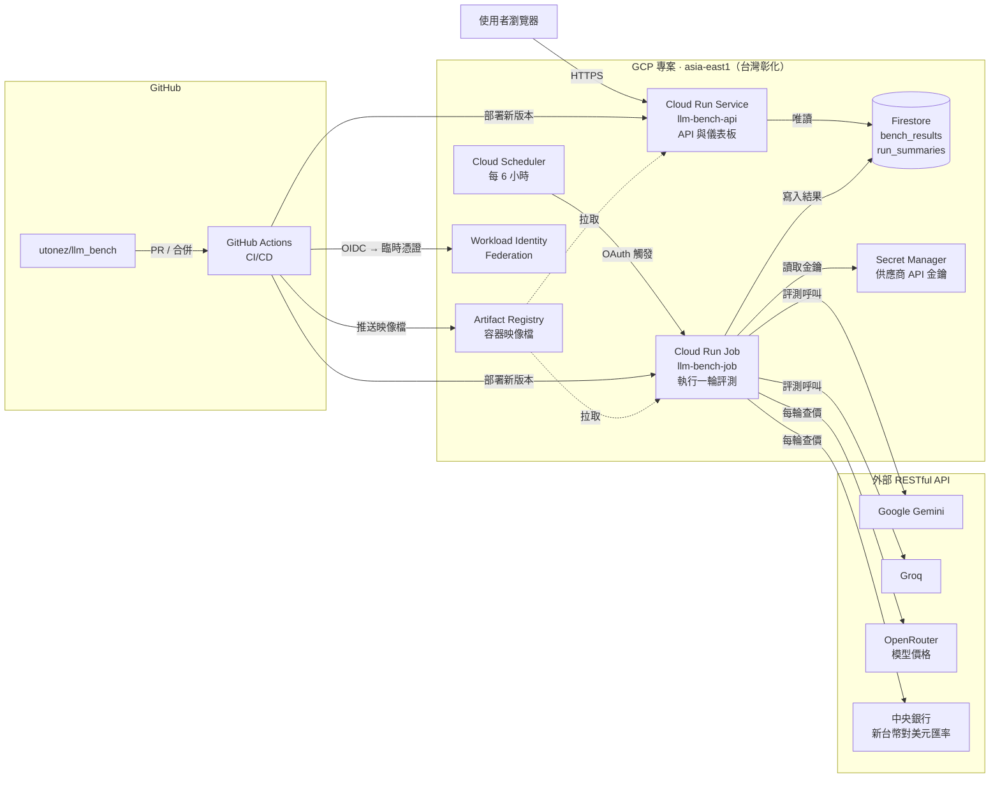

# 金融場景 LLM 評測平台（llm-bench）

[](https://github.com/utonez/llm_bench/actions/workflows/ci-cd.yml)

以一組**有出處的金融任務**，每 6 小時自動實測多個大型語言模型的**穩定度、延遲、正確率與新台幣成本**，作為企業導入生成式 AI 時的選型依據。

| | 連結 |
|---|---|
| 儀表板（線上） | https://llm-bench-api-ceu3sadvyq-de.a.run.app/ |
| API 文件（Swagger） | https://llm-bench-api-ceu3sadvyq-de.a.run.app/docs |
| 開發計畫 | [docs/PLAN.md](docs/PLAN.md) |

---

## 為什麼做這個

金融機構導入生成式 AI 時，最常遇到的問題是：**哪個模型該放進哪個業務？** 廠商的宣傳數字無法回答「在我們的任務上、從台灣呼叫、實際要多少錢」。

本平台用**固定的金融題庫、固定的排程**持續量測，讓選型決策有數據根據：

- **速度**：平均延遲、P95 延遲（95% 的請求比這個值快）
- **穩定度**：成功率，以及逾時、限流、伺服器錯誤等錯誤類型
- **正確率**：分類題與欄位抽取題自動比對標準答案
- **成本**：token 用量 × 公開的市場參考價 × 中央銀行匯率，換算成新台幣

## 主要功能

| 功能 | 說明 |
|---|---|
| 定期評測 | Cloud Scheduler 每 6 小時觸發一輪：27 題 × 5 個模型 |
| 有出處的題庫 | Banking77、Financial PhraseBank、金管會與中央銀行新聞稿，每題都可追溯來源（[tasks/README.md](tasks/README.md)） |
| 新台幣成本 | 每輪記錄當下的 OpenRouter 價格與央行匯率，之後價格變動不會改寫歷史 |
| 查詢 API | `GET /v1/stats`、`/v1/timeseries`、`/v1/models`；唯讀、有速率限制與快取 |
| 儀表板 | 自動產生的「本期結論」、模型能力比較、排行、趨勢圖、每月成本試算 |
| CI/CD | PR 自動測試；合併後自動建置、部署並在線上做 smoke test |
| 基礎設施即程式碼 | 全部 GCP 資源以 Terraform 建立 |

## 系統架構



<details>
<summary>Mermaid 原始碼（<code>docs/diagrams/architecture.mmd</code>）</summary>



</details>

**兩條主要流程：**

1. **評測**：Cloud Scheduler 每 6 小時觸發 Cloud Run Job → Job 從 Secret Manager 取得金鑰 → 抓取當下價格與匯率 → 依序呼叫各模型（同一供應商的呼叫之間保持間隔，避免超過免費額度的每分鐘上限）→ 每次呼叫的結果與每輪摘要寫入 Firestore。
2. **查詢**：使用者開啟儀表板 → 同一個 Cloud Run 服務提供頁面與 API → API 讀取 Firestore 的每輪摘要（快取 5 分鐘）→ 計算統計與成本後回傳。

**設計重點：** 同一個 Docker 映像檔有兩種執行方式（API 與 Job），程式碼只有一份、部署一次就兩邊都更新。

## 雲端服務與選用原因

| 服務 | 用途 | 為什麼選它 | 考慮過的替代方案 |
|---|---|---|---|
| **Cloud Run Service** | 查詢 API + 儀表板 | 直接部署容器；沒有流量時縮到零；有永久免費額度；最多 1 個執行個體，成本有上限 | Compute Engine（24 小時計費、要自己維護系統）、GKE（對單一服務太重） |
| **Cloud Run Job + Cloud Scheduler** | 定期評測 | 批次工作做完就結束、不常駐；與 API 共用映像檔；Scheduler 前 3 個排程免費 | 在 API 裡開背景執行緒（服務縮到零時會被停掉，也會互相拖慢） |
| **Firestore** | 評測結果 | Serverless、免費額度足夠、不用管理資料庫；以每輪摘要讓一週的查詢約 84 次讀取 | Cloud SQL（沒有免費方案）、BigQuery（適合分析，不適合作為 API 的即時資料庫） |
| **Secret Manager** | API 金鑰 | 金鑰不進程式碼、映像檔或 Terraform state；有版本與存取稽核；只有評測 Job 能讀 | 直接設成環境變數（看得到明文、沒有稽核紀錄） |
| **Artifact Registry** | 容器映像檔 | Cloud Run 原生支援、同區域拉取；以清理政策維持在 0.5 GB 免費額度內 | Docker Hub / GHCR（Cloud Run 無法直接拉取 GHCR） |
| **Workload Identity Federation** | CI/CD 登入 GCP | GitHub 上**沒有任何長期金鑰**；GCP 端限定只接受本 repo 的 `main` 分支 | 服務帳號 JSON 金鑰（永久有效、外洩風險高） |
| **Terraform** | 基礎設施即程式碼 | 環境可重建、變更可審查（plan）、業界通用 | 在主控台手動點選（無法重現、無法審查） |
| **asia-east1（台灣）** | 部署區域 | 資料留在台灣，符合金融業對資料存放地點的要求；國內使用者延遲低 | — |

各項決策的完整理由見 [docs/adr/](docs/adr/)。

## 實測結果（截至 2026-11-23 的快照）

| 模型 | 供應商 | 成功率 | P95 延遲 | 正確率 | 每千次成本 |
|---|---|---|---|---|---|
| qwen3.8-27b | Groq | 100% | 0.6 秒 | 95% | NT$ 1.40 |
| gpt-oss-20b | Groq | 100% | 1.0 秒 | 84% | NT$ 1.41 |
| gpt-oss-120b | Groq | 100% | 1.6 秒 | 95% | NT$ 2.02 |
| gemini-3.5-flash-lite | Gemini | 99% | 5.0 秒 | 99% | NT$ 3.99 |
| gemini-3.1-flash-lite | Gemini | 78% | 3.2 秒 | 100% | NT$ 1.97 |

最新數據請見線上儀表板。幾個觀察：

- **速度與正確率有取捨**：Gemini 正確率最高，但延遲的長尾明顯（P95 曾超過 20 秒）；Groq 的模型穩定在 1 秒左右。
- **新世代更穩定**：Gemini flash-lite 3.5 的成功率明顯高於 3.1。
- **模型越大不一定越好**：gpt-oss-120b 的正確率提升有限，延遲與成本卻較高。
- **推理型模型的隱藏成本**：gpt-oss 在作答前會先推理，輸出 token 約是答案本身的十幾倍；儀表板保留這部分，呈現真實成本。

## CI/CD 與 Git 協作流程

- [docs/cicd.md](docs/cicd.md)：CI/CD 流程圖與安全設計
- [docs/git-workflow.md](docs/git-workflow.md)：多人協作的 Git 流程圖，以及本專案實際走過的 PR 紀錄

## 安全設計摘要

- **沒有長期金鑰**：CI/CD 透過 Workload Identity Federation 取得臨時憑證；供應商 API 金鑰只存在 Secret Manager
- **最小權限**：評測 Job、API、排程器、部署帳號各自有獨立的服務帳號，只授予必要權限（例如 API 只能讀 Firestore，讀不到任何金鑰）
- **公開 API 防護**：只允許 GET、參數驗證、速率限制、快取、嚴格的 CSP 與安全標頭、錯誤訊息不洩漏內部細節
- **供應鏈**：相依套件以雜湊鎖定（`requirements.lock`）、基底映像檔固定 digest、GitHub Actions 固定 commit SHA、Chart.js 經過完整性驗證後放進專案
- **main 分支保護**：必須透過 PR、CI 全部通過才能合併，管理員也不例外

## 成本

全部資源都在 GCP 免費額度內運作，LLM 呼叫也使用各供應商的免費額度。唯一確定的費用是 Terraform 狀態儲存桶（asia-east1，檔案僅數 KB，每月遠低於新台幣 1 元）。帳單帳戶另設有預算警報。

## 題目要求與加分項對照

| 項目 | 對應內容 |
|---|---|
| Python 程式碼 | `app/`（FastAPI、評測核心）、`jobs/`（排程進入點） |
| 雲端架構圖 | 本頁「系統架構」 |
| 用途、功能、服務選用原因 | 本頁，以及 [docs/adr/](docs/adr/) |
| ① 前端 | [frontend/](frontend/)：四頁式儀表板 |
| ② 第三方 RESTful API | Gemini、Groq、OpenRouter（價格）、中央銀行（匯率） |
| ③ CI/CD | [.github/workflows/ci-cd.yml](.github/workflows/ci-cd.yml)、[docs/cicd.md](docs/cicd.md) |
| ④ 多人協作 Git 流程 | [docs/git-workflow.md](docs/git-workflow.md)：8 個 PR 皆經過分支 → PR → CI → 合併 |
| ⑤ IaC | [infra/terraform/](infra/terraform/) |
| ⑥ AI 輔助開發 | [docs/ai-assisted-development.md](docs/ai-assisted-development.md) |

## 本機執行

```bash
python -m venv .venv
.venv/Scripts/python -m pip install --require-hashes -r requirements.lock   # Windows；macOS/Linux 為 .venv/bin/python
.venv/Scripts/python -m pip install -e ".[dev]"

# 不需要任何金鑰：用模擬供應商跑一輪
TARGETS_PATH=config/targets_mock.yaml .venv/Scripts/python -m jobs.run_bench

# 測試
.venv/Scripts/python -m pytest
cd frontend && node --test "lib/**/*.test.js"
```

使用真實模型時，把 `.env.example` 複製成 `.env` 並填入金鑰；部署步驟見 [infra/README.md](infra/README.md)。

## 目錄結構

```
app/
  api/        FastAPI：路由、服務層、中介層（速率限制、安全標頭）
  bench/      評測核心：執行器、評分、統計、每輪摘要
  pricing/    OpenRouter 價格、中央銀行匯率、成本計算
  providers/  供應商轉接（相容 OpenAI 格式）、模擬供應商、受測模型設定
  storage/    儲存介面、記憶體版、Firestore 版
jobs/         run_bench（排程評測）、list_models（查詢可用模型）
config/       受測模型清單
tasks/        題庫（每題附出處）
frontend/     儀表板（無建置步驟的 ES modules）
infra/        Terraform 與部署說明
tests/        Python 測試（122 個）
docs/         計畫、ADR、CI/CD、Git 流程、AI 開發心得、面試問答
```
