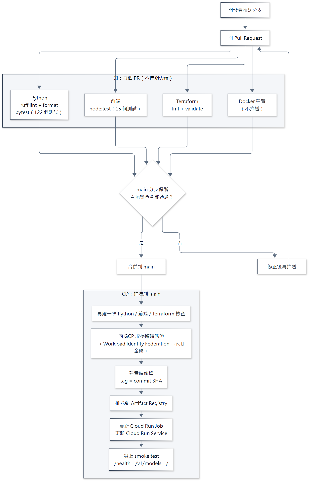
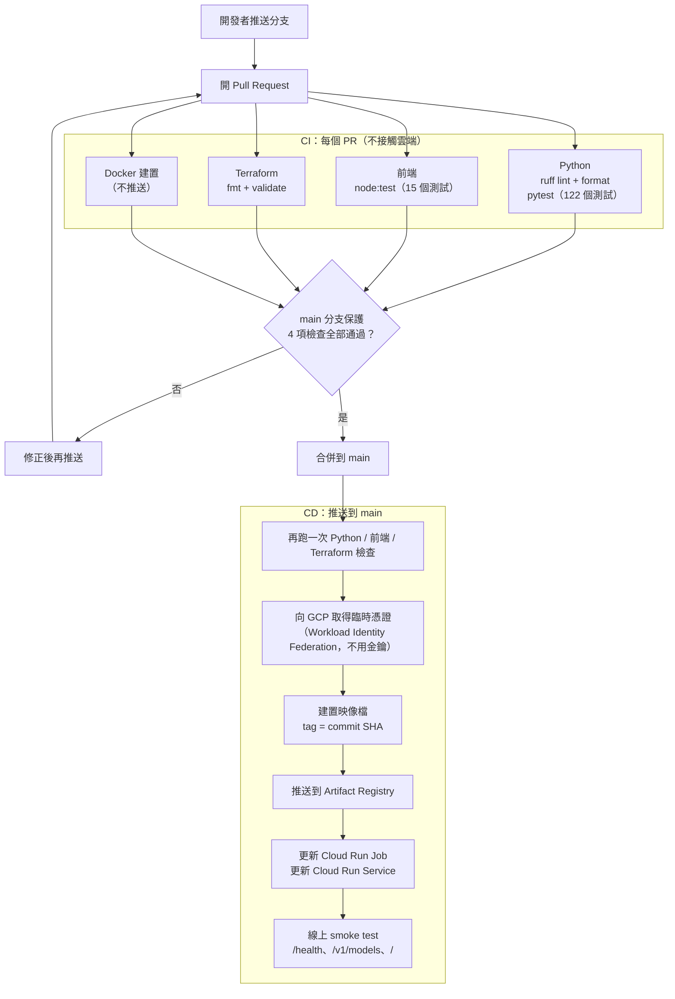

# CI/CD

Workflow 定義：[.github/workflows/ci-cd.yml](../.github/workflows/ci-cd.yml)；GCP 端設定：[infra/terraform/cicd.tf](../infra/terraform/cicd.tf)

## 流程圖

Mermaid 原始碼（<code>docs/diagrams/cicd.mmd</code>）

## 為什麼這樣設計

| 設計 | 原因 |
|---|---|
| PR 階段完全不接觸雲端 | PR 可能來自任何人（包括 fork），不應該拿到任何雲端權限 |
| **Workload Identity Federation** | GitHub 每次執行時簽發 OIDC token，由 GCP 換發約 1 小時有效的臨時憑證。GitHub 上**沒有存放任何 GCP 金鑰**，也就沒有金鑰可以外洩 |
| 限制寫在 GCP 端 | provider 的 `attribute_condition` 只接受 `utonez/llm_bench` 的 `refs/heads/main`。就算有人修改 workflow 檔，從其他分支也拿不到憑證 |
| 部署帳號最小權限 | `gh-deployer` 只能推送映像檔到這個 repository、更新現有的 Job 和服務，並以它們原本的身分執行。**不能修改 IAM，也不能建立資源**；基礎設施變更仍然由人審查 `terraform plan` 後執行 |
| 映像檔 tag 使用 commit SHA | 每個線上版本都能追溯到確切的程式碼 |
| 部署後做 smoke test | 部署成功不代表服務正常；實際打線上網址確認 |
| Terraform 忽略映像檔版本 | 映像檔版本由 CI 管理，避免之後的 `terraform apply` 把已部署的版本改回舊的 |
| Actions 固定 commit SHA | 第三方 action 的 tag 可以被移動；固定 SHA 才能確保執行的程式碼不會被替換 |
| `concurrency` | 同時只會有一個部署在執行，避免兩次部署互相覆蓋 |

## 為什麼 Terraform 不在 CI 裡自動 apply

自動 apply 需要給 CI 很大的權限（建立服務帳號、修改 IAM）。基礎設施變更的頻率低、影響大，在這個規模下由人審查 plan 後手動執行，比讓 CI 擁有專案的管理權限更安全。CI 仍然會在每個 PR 檢查 Terraform 的格式與語法。

## 實際紀錄

CI/CD 上線後，每次合併都會自動部署。第一次自動部署之後，`terraform plan` 顯示 gcloud 寫入的 metadata 與設定不一致，因此開了一個 PR 修正（#7），之後 `terraform plan` 恢復為「No changes」。
