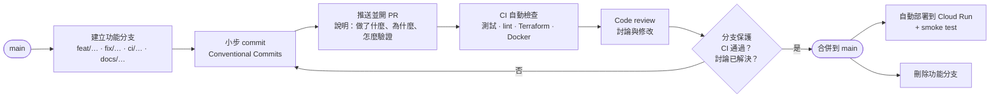
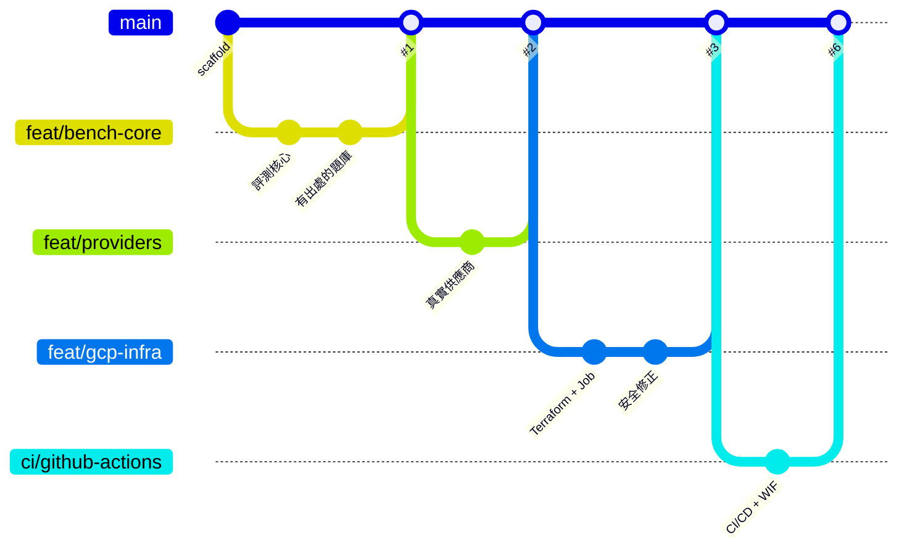

# 多人協作 Git 流程

本專案採用 **GitHub Flow**：`main` 永遠是可部署的狀態，所有變更都從短期分支開始，經過 PR 與 CI 才能合併，合併後自動部署。

## 流程圖

## 規則

| 規則 | 設定方式 |
|---|---|
| `main` 不能直接推送 | GitHub 分支保護：必須透過 PR |
| CI 必須通過 | 必要檢查：Python tests & lint、Frontend tests、Terraform fmt & validate、Docker build |
| 分支必須是最新的 | `strict: true`：合併前要包含 `main` 的最新變更 |
| 討論必須解決 | `required_conversation_resolution` |
| 管理員也不例外 | `enforce_admins: true` |
| 不能強制推送或刪除 `main` | `allow_force_pushes: false`、`allow_deletions: false` |
| 分支命名 | `feat/`（功能）、`fix/`（修正）、`ci/`（CI/CD）、`docs/`（文件） |
| Commit 訊息 | Conventional Commits：`feat:`、`fix:`、`ci:`、`docs:`、`test:`、`chore:` |

多人協作時再加上：至少 1 位 reviewer 核准（目前只有一位開發者，GitHub 不允許核准自己的 PR，所以設為 0）、CODEOWNERS 指定各目錄的負責人。

## 本專案實際走過的 PR

| PR | 分支 | 內容 |
|---|---|---|
| #1 | `feat/bench-core` | 評測核心與有出處的題庫 |
| #2 | `feat/providers` | 串接真實的 LLM 供應商 |
| #3 | `feat/gcp-infra` | Terraform、Cloud Run Job、Scheduler；安全審查後的修正記錄在 PR 留言中 |
| #4 | `feat/api-cost` | 查詢 API 與新台幣成本 |
| #5 | `feat/dashboard` | 儀表板（包含改版與分頁） |
| #6 | `ci/github-actions` | CI/CD 與不需要金鑰的部署 |
| #7 | `fix/terraform-gcloud-client-drift` | 第一個受分支保護把關的 PR |
| #8 | `feat/more-models` | 受測模型從 3 個增加到 5 個 |

每個 PR 的說明都包含：變更內容、設計理由、審查重點與測試計畫。
